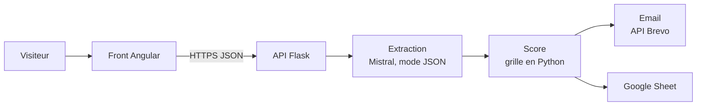

# Qualification de leads par IA - démo

Le formulaire de contact d'une agence web **fictive** (Atelier Ardoise, Bordeaux).
Chaque demande est lue par une IA, notée de 1 à 10, résumée, puis transmise à l'agence
par email et ajoutée à un Google Sheet, en moins de 10 secondes.

## Architecture



**L'IA lit, le code note.** Le modèle extrait des champs (type de projet, budget,
échéance, décideur, clarté, points d'attention, résumé), validés par un schéma
pydantic strict. Le score est calculé ensuite par une grille fixe en Python : il
s'explique ligne par ligne, et un visiteur ne peut pas l'obtenir en le réclamant
dans son message.

| Critère | Points | Règle |
|---|---|---|
| Base | 1 | Toute demande pertinente |
| Budget | 0 à 4 | Non précisé 1, moins de 1 500 € 0, jusqu'à 5 000 € 2, jusqu'à 15 000 € 3, au-delà 4 |
| Délai | 0 à 2 | Sous 3 mois 2, sans échéance ferme 1, non précisé 0 |
| Clarté | 0 à 2 | Précis 2, partiel 1, flou 0 |
| Interlocuteur | 0 à 1 | Décideur 1 |

8 à 10 : chaud, 5 à 7 : tiède, 1 à 4 : froid. Hors du métier de l'agence
(démarchage, candidature) : 1, catégorie "hors cible".

Backend Flask en 3 couches :

| Couche | Rôle |
|---|---|
| `app/api/` | Routes, validation (pydantic), format d'erreur unique, rate limiting |
| `app/services/` | Extraction, grille de score, mise en forme du Sheet et de l'email, orchestration |
| `app/infra/` | Client Mistral, Google Sheets (compte de service), email (API Brevo ou SMTP), quota journalier |

Le Sheet et l'email partent en parallèle. Si l'un des deux échoue, le lead reste
qualifié et la réponse indique quel canal a échoué.

## Lancer en local

```sh
cd backend
python -m venv .venv
.venv/Scripts/pip install -r requirements-dev.txt     # Linux/macOS : .venv/bin/pip
cp .env.example .env                                 # renseigner au moins MISTRAL_API_KEY
.venv/Scripts/python wsgi.py                         # API sur http://localhost:5000
```

Sans Google ni email configurés, la démo fonctionne : les envois sont simplement
affichés comme désactivés.

```sh
cd frontend
npm ci
npm start                                            # http://localhost:4200, /api passe par le proxy
```

## Configurer les sorties

### Google Sheet

1. Créer un projet sur https://console.cloud.google.com et activer **Google Sheets API**.
2. IAM et administration > Comptes de service > Créer. Aucun rôle n'est nécessaire.
   Onglet Clés > Ajouter une clé > JSON : le fichier se télécharge.
3. Créer un Google Sheet, renommer l'onglet en `Leads`.
4. Partager le Sheet avec l'adresse du compte de service (`...@...iam.gserviceaccount.com`),
   droit **Éditeur**. Puis "Toute personne disposant du lien" en **Lecteur** : c'est le
   lien montré aux visiteurs.
5. Dans `.env` : `SHEET_ID` (l'identifiant dans l'URL du Sheet) et
   `GOOGLE_SERVICE_ACCOUNT` (le contenu du JSON, ou sa version base64 :
   `base64 -w0 cle.json`, plus simple à coller chez un hébergeur).
6. `python scripts/setup_sheet.py` écrit la ligne d'en-tête.

### Email (Brevo, offre gratuite : 300 emails par jour)

1. Créer un compte sur https://www.brevo.com, valider une adresse d'expéditeur
   (idéalement authentifier le domaine : code Brevo, DKIM et DMARC dans le DNS).
2. SMTP et API > Clés API : générer une clé API (https://app.brevo.com/settings/keys/api).
3. Dans `.env` : `BREVO_API_KEY`, `MAIL_FROM` (l'expéditeur validé, avec un nom
   d'affichage facultatif : `Nom <adresse>`) et `MAIL_TO` (la boîte de démo qui reçoit
   les leads).

L'envoi passe par l'API HTTP de Brevo, sur le port 443. Le SMTP reste possible
(`SMTP_USER`, `SMTP_PASSWORD`, sans `BREVO_API_KEY`), mais beaucoup d'hébergeurs
bloquent la sortie SMTP : sur Sevalla, la connexion au port 587 restait suspendue
jusqu'au délai d'attente de 10 secondes, et l'email n'arrivait jamais.

Si Brevo refuse la clé depuis le serveur (`401`, adresse IP non reconnue), désactiver
le blocage des IP inconnues dans Sécurité > IP autorisées.

## Tests

```sh
cd backend && .venv/Scripts/python -m pytest -q      # 37 tests, sans réseau
cd frontend && npm test                              # 6 tests
```

`scripts/eval.py` passe 7 demandes types dans le vrai Mistral (chaude, tiède,
irréaliste, relayée par une assistante, démarchage, candidature, tentative de
manipulation) et vérifie leur catégorie et le délai de 10 secondes.

## API

| Méthode | Route | Rôle |
|---|---|---|
| GET | `/api/health` | État, lien public du Sheet, email actif ou non |
| POST | `/api/leads` | `{name, email, company, message}` -> `{score, lead, delivery, latency_ms}` |

Erreurs : `{"error": {"code", "message", "fields"?}}` avec `invalid_lead` (400, liste
des champs à corriger), `spam_detected` (400), `rate_limited` (429), `demo_paused`
(503, quota du jour atteint), `llm_unavailable` (502).

## Sécurité et coûts

- Le message est encadré comme une donnée dans le prompt ; une consigne glissée
  dedans est ignorée et signalée (voir le cas "manipulation" de l'évaluation).
- Le score est calculé en code, à partir de champs validés par schéma.
- Destinataire de l'email fixe (`MAIL_TO`) : le formulaire ne peut pas relayer de spam.
  Champs inconnus refusés, retours à la ligne retirés de ce qui va dans l'objet.
- Le Sheet reçoit du texte brut (`valueInputOption=RAW`) : une valeur commençant
  par `=` n'est jamais exécutée comme formule. Email masqué et nom réduit à
  l'initiale, car le Sheet est public.
- Champ piège invisible contre les robots, rate limit par IP (10/heure, 3/minute)
  et quota global de 100 demandes par jour (budget Mistral et quota Brevo).
- Pas de nom ni d'email dans les journaux, seulement score, catégorie et délai.

## Déploiement

Prévu dans l'app Sevalla qui héberge les démos du portfolio (dépôt `portfolio-demos`,
dossier `sevalla/`), sous `demo-leads.maximenkengato.com` : ce dépôt y est figé
par `vendor.sh`, le front est compilé dans l'image et servi par nginx avec l'API
sur le même domaine.

- API : `gunicorn wsgi:app --workers 1 --threads 4`
  (1 worker : le rate limit et le quota sont en mémoire)
- Variables : `MISTRAL_API_KEY`, et pour les sorties celles de `.env.example`.
- Python 3.11 ou plus.
